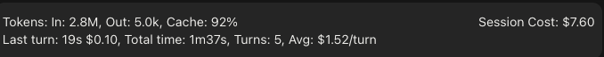
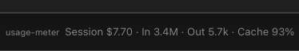

# usage-meter

Live per-session usage in Claude Code: tokens, cache hit and session cost. It reads figures the engine already reports, so it costs no tokens.

> **Costs no tokens.** The mod only displays figures the engine already reports. It makes no model calls and adds nothing to your context.



Or in the status line (`/usage-meter status`):



## Install

Two steps: add the marketplace, then install the plugin.

At the prompt of a terminal session:

```
/plugin marketplace add patradinesh/claude-usage-meter
```

```
/plugin install usage-meter@claude-usage-meter
```

From a shell:

```bash
claude plugin marketplace add patradinesh/claude-usage-meter
```

```bash
claude plugin install usage-meter@claude-usage-meter
```

In the desktop app, where `/plugin` does not run: click + next to the prompt box, then Plugins, Add marketplace with `patradinesh/claude-usage-meter`, then Add plugin.

## Remove

Uninstall the plugin, then remove the marketplace.

At the prompt of a terminal session:

```
/plugin uninstall usage-meter@claude-usage-meter
```

```
/plugin marketplace remove claude-usage-meter
```

From a shell:

```bash
claude plugin uninstall usage-meter
```

```bash
claude plugin marketplace remove claude-usage-meter
```

In the desktop app: open Plugins, remove usage-meter, then remove the marketplace.

## What it shows

```
Tokens: In: 1.0k, Out: 300, Cache: 80%                    Session Cost: $0.50
```

- **In / Out:** tokens this session. In includes cached input.
- **Cache:** share of input read from the prompt cache.
- **Session Cost:** what this session has cost so far.

With detail on, a second row adds last turn time and cost, total time, turn count and average cost per turn.

## Choose where and how

Run `/usage-meter` to see the options:

| Command | Effect |
| --- | --- |
| `/usage-meter band` | Row above the prompt |
| `/usage-meter status` | Status line (shows the plugin name) |
| `/usage-meter detail on` / `off` | Add or remove last turn time and cost, total time, turns and average cost |

**In/Out** tokens · **Cache** input read from cache · **Session** cost so far

The same options are in the plugin's config menu as the defaults.

## Limits

- The status line shows the plugin name as a label, added by the engine, and long text can truncate.
- Counts start when the mod loads, so earlier turns in a session are not counted.
- Per-turn cost is the rise in session cost during the turn. Subagent cost is included.

## Feedback

Found a bug or have an idea? [Open an issue](https://github.com/patradinesh/claude-usage-meter/issues).

## License

[MIT](LICENSE)
